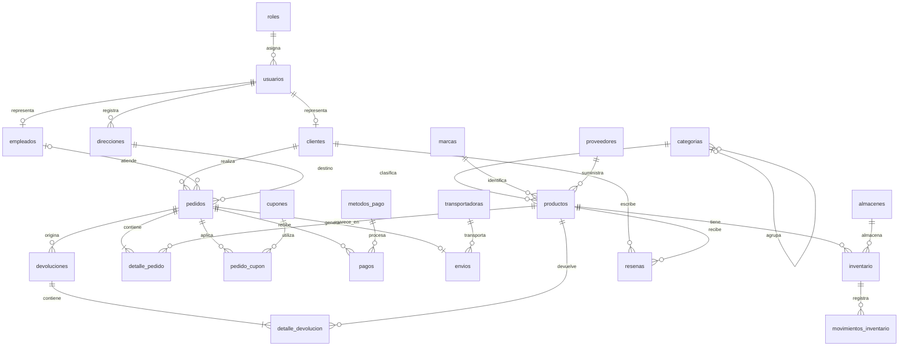

<div align="center">

# 🛒 ComercioPlus

**Base de datos relacional para practicar SQL con MySQL**

[](https://www.mysql.com/)


**ComercioPlus** simula la operación de un comercio electrónico: clientes, catálogo de productos, ventas, inventario, pagos, envíos, promociones y devoluciones. Está diseñada para practicar desde consultas SQL básicas hasta análisis relacional y funciones avanzadas.

</div>

---

## 📌 Contenido

- [Características](#-características)
- [Volumen de datos](#-volumen-de-datos)
- [Archivos](#-archivos)
- [Instalación](#-instalación)
- [Estructura de la base de datos](#-estructura-de-la-base-de-datos)
- [Modelo entidad-relación](#-modelo-entidad-relación)
- [Integridad referencial](#-integridad-referencial)
- [Vistas e índices](#-vistas-e-índices)
- [Consultas de práctica](#-consultas-de-práctica)
- [Validación y calidad de los datos](#-validación-y-calidad-de-los-datos)
- [Tecnologías y herramientas](#-tecnologías-y-herramientas)
- [Requisitos](#-requisitos)
- [Sobre los datos](#-sobre-los-datos)

## ✨ Características

| Característica | Descripción |
|---|---|
| 🧱 Modelo relacional | 23 tablas relacionadas mediante claves primarias y foráneas |
| 📦 Datos de prueba | 6.960 registros sintéticos distribuidos en las tablas |
| 🔗 Integridad referencial | 27 restricciones `FOREIGN KEY` |
| 👁️ Vistas | 3 vistas para consultar información consolidada |
| ⚡ Índices | 4 índices adicionales para apoyar consultas frecuentes |
| 📊 Consultas | 28 ejemplos entre el script principal y el archivo complementario |
| 🧠 SQL avanzado | Subconsultas, agregaciones, anti-joins y funciones de ventana |

## 📈 Volumen de datos

La base contiene **23 tablas y 6.960 registros**.

| Área | Tablas | Registros |
|---|---|---:|
| 👥 Usuarios | `roles`, `usuarios`, `direcciones`, `clientes`, `empleados` | 618 |
| 🏷️ Catálogo | `categorias`, `marcas`, `proveedores`, `productos` | 197 |
| 🏬 Inventario | `almacenes`, `inventario`, `movimientos_inventario` | 1.504 |
| 🛍️ Ventas | `pedidos`, `detalle_pedido`, `pedido_cupon`, `cupones` | 3.024 |
| 💳 Pagos y envíos | `metodos_pago`, `pagos`, `transportadoras`, `envios` | 1.090 |
| ↩️ Posventa | `devoluciones`, `detalle_devolucion`, `resenas` | 527 |
| **Total** | **23 tablas** | **6.960** |

### Distribución de registros por tabla

| Tabla | Registros | Tabla | Registros |
|---|---:|---|---:|
| `roles` | 4 | `usuarios` | 193 |
| `direcciones` | 229 | `clientes` | 180 |
| `empleados` | 12 | `categorias` | 12 |
| `marcas` | 20 | `proveedores` | 15 |
| `productos` | 150 | `almacenes` | 4 |
| `inventario` | 600 | `movimientos_inventario` | 900 |
| `pedidos` | 700 | `detalle_pedido` | 2.075 |
| `pedido_cupon` | 234 | `cupones` | 15 |
| `metodos_pago` | 6 | `pagos` | 606 |
| `transportadoras` | 8 | `envios` | 470 |
| `devoluciones` | 17 | `detalle_devolucion` | 17 |
| `resenas` | 493 | | |

## 📁 Archivos

| Archivo | Descripción |
|---|---|
| [`ComercioPlus_MySQL.sql`](ComercioPlus_MySQL.sql) | Script principal: crea la base de datos, las 23 tablas, inserta los datos, crea las vistas y los índices. Incluye 10 consultas comentadas. |
| [`Consultas_Practica_ComercioPlus.sql`](Consultas_Practica_ComercioPlus.sql) | Banco complementario con 18 consultas SQL listas para ejecutar. |

## 🚀 Instalación

> [!WARNING]
> El script principal comienza con `DROP DATABASE IF EXISTS ComercioPlus;`. Si ya existe una base de datos con ese nombre, **se eliminará y se volverá a crear**. Realiza una copia de seguridad si necesitas conservarla.

### Opción 1: MySQL Workbench

1. Abre MySQL Workbench y conéctate a tu servidor.
2. Selecciona **File → Open SQL Script**.
3. Abre `ComercioPlus_MySQL.sql`.
4. Ejecuta el script completo con el botón del rayo ⚡.
5. Actualiza el panel **SCHEMAS** y comprueba que aparezca `ComercioPlus`.
6. Abre `Consultas_Practica_ComercioPlus.sql` y ejecuta las consultas que quieras probar.

### Opción 2: Terminal

Ejecuta los comandos desde la carpeta donde guardaste los archivos:

```bash
mysql -u root -p < ComercioPlus_MySQL.sql
mysql -u root -p ComercioPlus < Consultas_Practica_ComercioPlus.sql
```

El segundo comando selecciona explícitamente la base `ComercioPlus` antes de ejecutar el banco de consultas.

## 🧩 Estructura de la base de datos

| Módulo | Tablas | Función |
|---|---|---|
| 👥 Usuarios | `roles`, `usuarios`, `clientes`, `empleados`, `direcciones` | Gestiona usuarios, perfiles y direcciones. |
| 🏷️ Catálogo | `categorias`, `marcas`, `proveedores`, `productos` | Organiza los productos y sus datos comerciales. |
| 🏬 Inventario | `almacenes`, `inventario`, `movimientos_inventario` | Controla existencias por almacén y sus movimientos. |
| 🛍️ Ventas | `pedidos`, `detalle_pedido`, `pedido_cupon`, `cupones` | Registra pedidos, productos vendidos y descuentos. |
| 💳 Pagos | `metodos_pago`, `pagos` | Registra los medios y estados de pago. |
| 🚚 Logística | `transportadoras`, `envios` | Administra transportadoras y seguimiento de envíos. |
| ↩️ Posventa | `devoluciones`, `detalle_devolucion`, `resenas` | Gestiona devoluciones y opiniones de productos. |

## 🗺️ Modelo entidad-relación

El siguiente diagrama muestra las relaciones principales entre las 23 tablas. Las relaciones se implementan mediante claves primarias y foráneas en el script SQL.



### 🔑 Convenciones del modelo

- **PK (`PRIMARY KEY`):** identifica de forma única cada registro.
- **FK (`FOREIGN KEY`):** referencia la clave primaria de otra tabla y establece la relación.
- **UNIQUE:** evita valores duplicados en los campos o combinaciones definidos.
- **NOT NULL:** obliga a proporcionar un valor.
- **1:N:** un registro de una tabla puede relacionarse con varios registros de otra.
- **1:1:** relación de uno a uno; por ejemplo, un pedido puede tener como máximo un envío registrado.

## 🔐 Integridad referencial

El esquema contiene **27 restricciones de claves foráneas** distribuidas entre las 23 tablas. Estas restricciones conectan los registros y ayudan a impedir referencias inválidas durante las operaciones normales de inserción y actualización.

El diseño también utiliza:

- `PRIMARY KEY` para identificar cada registro.
- `FOREIGN KEY` para establecer relaciones entre entidades.
- `UNIQUE` para controlar duplicados en identificadores, correos, SKU y otras columnas.
- `NOT NULL` para definir campos obligatorios.
- `AUTO_INCREMENT` para generar identificadores numéricos.

### Comprobar las claves foráneas

Puedes ejecutar esta consulta para inspeccionar las relaciones creadas en MySQL:

```sql
USE ComercioPlus;

SELECT
    TABLE_NAME AS tabla,
    COLUMN_NAME AS columna_fk,
    CONSTRAINT_NAME AS restriccion,
    REFERENCED_TABLE_NAME AS tabla_referenciada,
    REFERENCED_COLUMN_NAME AS columna_referenciada
FROM information_schema.KEY_COLUMN_USAGE
WHERE TABLE_SCHEMA = 'ComercioPlus'
  AND REFERENCED_TABLE_NAME IS NOT NULL
ORDER BY TABLE_NAME, COLUMN_NAME;
```

### Comprobar las tablas y los registros

```sql
USE ComercioPlus;

SELECT
    TABLE_NAME AS tabla,
    TABLE_ROWS AS filas_aproximadas
FROM information_schema.TABLES
WHERE TABLE_SCHEMA = 'ComercioPlus'
  AND TABLE_TYPE = 'BASE TABLE'
ORDER BY TABLE_NAME;
```

> **Nota técnica:** el script desactiva temporalmente `FOREIGN_KEY_CHECKS` durante la carga masiva y vuelve a activarlo al finalizar. MySQL no vuelve a validar automáticamente las filas cargadas mientras la comprobación estaba desactivada. Por eso, si modificas los datos de inserción, conviene ejecutar consultas de auditoría para detectar posibles registros huérfanos.

## 👁️ Vistas e índices

### Vistas

| Vista | Descripción |
|---|---|
| `vw_ventas_por_cliente` | Muestra el número de pedidos y el total comprado por cliente, excluyendo pedidos cancelados del total. |
| `vw_stock_bajo` | Identifica productos cuya existencia es menor o igual al stock mínimo en cada almacén. |
| `vw_detalle_ventas` | Consolida información del pedido, cliente, producto, cantidad, precio y subtotal. |

Ejemplo:

```sql
SELECT *
FROM vw_ventas_por_cliente
ORDER BY total_comprado DESC
LIMIT 10;
```

### Índices adicionales

| Índice | Tabla | Columna |
|---|---|---|
| `idx_pedidos_fecha` | `pedidos` | `fecha_pedido` |
| `idx_pedidos_estado` | `pedidos` | `estado` |
| `idx_productos_precio` | `productos` | `precio` |
| `idx_resenas_calificacion` | `resenas` | `calificacion` |

Estos índices complementan los índices que MySQL crea para las claves primarias y las restricciones únicas.

## 🧪 Consultas de práctica

El proyecto incluye **28 consultas de ejemplo**: 10 comentadas al final del script principal y 18 en el archivo complementario.

| N.º | Consulta | Conceptos |
|---:|---|---|
| 1 | Top 10 productos más vendidos | `JOIN`, `SUM`, `GROUP BY`, `LIMIT` |
| 2 | Total facturado por vendedor | `LEFT JOIN`, `COUNT`, `SUM` |
| 3 | Clientes con más de cinco pedidos | `HAVING` |
| 4 | Ventas por categoría | JOIN de varias tablas y agregación |
| 5 | Promedio de pedidos por estado | `AVG`, `ROUND` |
| 6 | Pedidos superiores al promedio | Subconsulta escalar |
| 7 | Inventario consolidado por producto | `SUM`, `GROUP BY` |
| 8 | Devoluciones por motivo | Agrupación y ordenamiento |
| 9 | Clientes que compraron tecnología | `DISTINCT`, múltiples JOIN |
| 10 | Ranking de productos por ventas | `DENSE_RANK()` |
| 11 | Compras acumuladas por cliente | `SUM() OVER()` |
| 12 | Envíos por transportadora | `LEFT JOIN`, agregaciones |
| 13 | Productos sin reseñas | Anti-join, `IS NULL` |
| 14 | Cupones más utilizados | `LEFT JOIN`, `COUNT` |
| 15 | Ventas mensuales | `YEAR()`, `MONTH()` |
| 16 | Productos por proveedor | `LEFT JOIN`, `COUNT` |
| 17 | Pedidos enviados sin envío registrado | Validación de datos |
| 18 | Indicadores generales | Subconsultas escalares |

### Ejemplo: ranking de productos por ventas

```sql
SELECT
    id_producto,
    nombre,
    ventas,
    DENSE_RANK() OVER (ORDER BY ventas DESC) AS ranking
FROM (
    SELECT
        pr.id_producto,
        pr.nombre,
        SUM(dp.subtotal) AS ventas
    FROM productos pr
    JOIN detalle_pedido dp
        ON dp.id_producto = pr.id_producto
    GROUP BY pr.id_producto, pr.nombre
) AS resumen;
```

### Ejemplo: consulta de varias tablas

```sql
SELECT
    p.id_pedido,
    CONCAT(u.nombre, ' ', u.apellido) AS cliente,
    pr.nombre AS producto,
    dp.cantidad,
    dp.subtotal
FROM pedidos p
JOIN clientes c
    ON c.id_cliente = p.id_cliente
JOIN usuarios u
    ON u.id_usuario = c.id_usuario
JOIN detalle_pedido dp
    ON dp.id_pedido = p.id_pedido
JOIN productos pr
    ON pr.id_producto = dp.id_producto
ORDER BY p.fecha_pedido DESC;
```

## 🧹 Validación y calidad de los datos

Los datos son sintéticos y se generaron para practicar consultas. Algunos escenarios pueden contener inconsistencias intencionales o derivadas de la generación aleatoria, útiles para ejercicios de auditoría y limpieza.

Ejemplos documentados:

- La existencia acumulada puede superar la capacidad declarada de un almacén.
- Algunos cupones pueden aparecer asociados a pedidos fuera de su vigencia.
- Algunos pedidos pueden tener una fecha anterior al registro del cliente.
- Puede haber reseñas de clientes que no compraron el producto reseñado.

Estas situaciones permiten practicar:

- Detección de registros inconsistentes.
- Validación de reglas de negocio.
- Consultas de auditoría.
- Limpieza y transformación de datos.
- Diseño de restricciones adicionales.

## 🛠️ Tecnologías y herramientas

| Tecnología | Uso |
|---|---|
| MySQL 8.0+ | Motor de base de datos |
| SQL | Definición, manipulación y consulta de datos |
| MySQL Workbench | Administración y ejecución de scripts |
| DBeaver | Cliente alternativo para bases de datos |
| Visual Studio Code | Edición de archivos SQL |
| Mermaid | Visualización del modelo entidad-relación |

## 📋 Requisitos

- MySQL Server 8.0 o superior.
- MySQL Workbench, DBeaver, VS Code con extensión MySQL o terminal.
- Permisos para crear y eliminar bases de datos.
- Funciones de ventana disponibles en MySQL 8.0+ para las consultas que las utilizan.

## 📝 Sobre los datos

Todos los nombres, correos, teléfonos, productos, proveedores, pedidos y movimientos incluidos son **ficticios**. Los datos se utilizan exclusivamente con fines educativos y de práctica.

---

<div align="center">

**ComercioPlus** · Proyecto de práctica de bases de datos relacionales con MySQL

</div>
